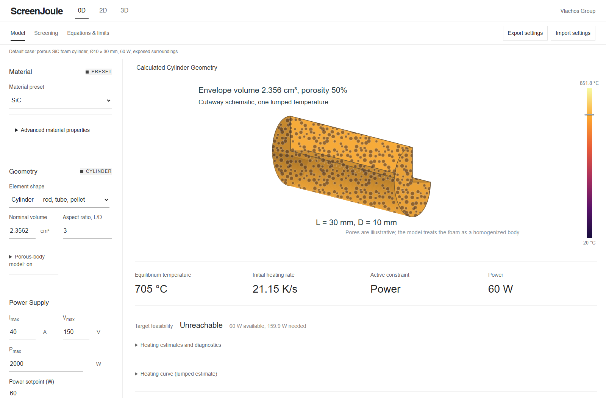

<h1 align="center">ScreenJoule</h1>

<p align="center">
  <strong>Browser-based electrothermal modeling for reactor design.</strong><br>
  Compare heater geometry, electrode placement and power-supply limits in 0D, 2D and 3D.
</p>

<p align="center">
  <a href="https://robin-yk.github.io/ScreenJoule/">Open the simulator</a> &nbsp; · &nbsp;
  <a href="#quick-start">Quick start</a> &nbsp; · &nbsp;
  <a href="docs/README.md">Documentation</a> &nbsp; · &nbsp;
  <a href="docs/verification.md">Verification</a> &nbsp; · &nbsp;
  <a href="research/README.md">Research data</a>
</p>

<p align="center">
  <a href="LICENSE"></a>
  
  <a href="CITATION.cff"></a>
</p>

<p align="center">
  <a href="https://robin-yk.github.io/ScreenJoule/">
    
  </a>
</p>

ScreenJoule helps researchers estimate whether an electrically heated element can reach a target temperature, how quickly it heats, and where current and temperature concentrate. Calculations run locally in the browser. No simulation server or commercial solver is needed to use the application.

## Model workspaces

| Workspace | Main calculations | Typical use |
| --- | --- | --- |
| **0D** | Resistance, available power, lumped temperature and heating time | Screen materials and power supplies before a spatial solve |
| **2D** | Axisymmetric electrical and temperature fields, surroundings and transients | Examine radial and axial gradients in cylindrical elements |
| **3D** | Geometry and electrode effects, temperature-dependent electrical feedback, optional Stokes gas flow and solid–gas heat transfer | Examine current concentration, partial contacts and shape-dependent heating |

All three workspaces start with the same porous SiC foam-cylinder inputs. Each workspace keeps its own settings after loading; switching tabs does not transfer them. The foam is modeled as a homogenized porous body, and displayed pores are illustrative. See the [shared-cylinder comparison](docs/shared-comparison.md) for the default inputs and recorded results.

## Quick start

**Use the application:** open [ScreenJoule](https://robin-yk.github.io/ScreenJoule/).

**Run a local copy:** Python 3 builds and serves the static pages. Node.js 22 or later runs the tests.

```sh
git clone https://github.com/robin-yk/ScreenJoule.git
cd ScreenJoule
python3 build.py
python3 -m http.server 8000 --directory dist
```

Open **http://localhost:8000**. Serve the pages over HTTP so module workers can load. On Windows, use `python` instead of `python3` if that is your Python command.

```sh
npm test
```

The test runner executes the regression scripts and Node test suites. Reports are written to `tests/results/`; retained literature inputs are in `research/literature/`.

## Scientific checks and limits

- **Numerical checks:** electrical and thermal balances, analytic solutions, spatial and time-step refinement, power-supply limits, and worker/direct execution comparisons.
- **OpenFOAM comparison:** six matched gas-flow and conjugate heat-transfer cases, with frozen solver sources, field data and reproduction commands. This checks agreement for the recorded equations and conditions; it is not experimental validation of every operating regime.
- **Literature comparisons:** each reactor case states its calibration or comparison basis. Prescribed fits and calibrated points remain identified.

The optional gas model uses constant-property, incompressible Stokes flow. Porous presets use effective properties. The 2D circuit uses mean element temperature to set total power; the 3D solver updates terminal conductance from the temperature-dependent electrical field. Use the [model documentation](docs/README.md) and [verification guide](docs/verification.md) to select a calculation appropriate to the question. Hardware safety assessment requires a separate engineering review.

## Repository structure

```text
src/          Application, numerical solvers and retained upstream source
dist/         Generated browser application
docs/         Model assumptions, verification and project documentation
research/     Study inputs, retained results and reproduction scripts
tests/        Node tests, regression scripts and numerical reports
scripts/      Test runner and literature-benchmark generator
```

| Task | Entry point |
| --- | --- |
| Understand the model assumptions | [Documentation](docs/README.md) |
| Review numerical and physical evidence | [Verification guide](docs/verification.md) |
| Reproduce the OpenFOAM comparison | [Six-case comparison package](research/gas-openfoam/README.md) |
| Find manuscript figures and source data | [Research index](research/README.md) |
| Change the code or report a problem | [Contributing](CONTRIBUTING.md) |

## Citation and license

Developed by **Yeonsu Kwak**. Use [CITATION.cff](CITATION.cff) to cite the software and record the commit used for a calculation.

The 0D/2D source originated in Electrification-Suite. Original commits and copied-file hashes are retained in the [source manifest](docs/source-manifest.json). See [LICENSE](LICENSE) for the MIT license and source attribution.
